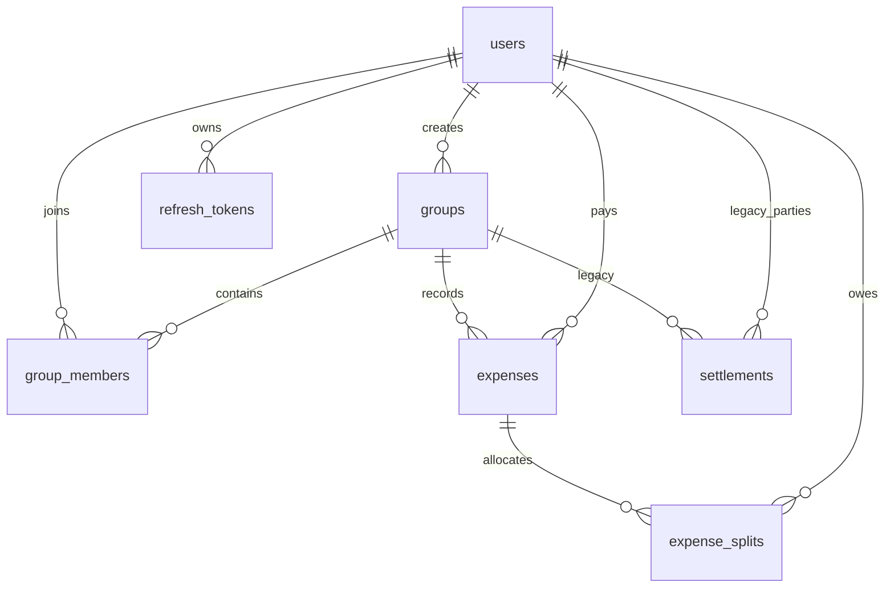

# Splitzy Database Design

## Relationships

## Tables and integrity rules

- `users`: UUID primary key; unique email; password hash, profile, and timestamps.
- `groups`: UUID primary key and creator foreign key; group metadata and timestamps.
  `deletedAt` is nullable; a non-null value archives the group without removing its
  membership or ledger history.
- `group_members`: UUID primary key, unique `(userId, groupId)`, and a role string.
  The group creator is created as `ADMIN`; member management is admin-only.
- `expenses`: UUID primary key, group and payer foreign keys, a `SplitType` enum,
  and decimal amount. `deletedAt` archives an entry; active balances and lists
  exclude archived expenses.
- `expense_splits`: expense/user foreign keys, decimal split amounts, and unique
  `(expenseId, userId)`.
- `refresh_tokens`: unique SHA-256 token hash, user foreign key with cascade on
  user deletion, and expiry timestamp. Raw refresh tokens are only sent in an
  HTTP-only cookie.
- `settlements`: legacy table retained for compatibility with any existing data.
  The application’s canonical settlement representation is an `expenses` row
  with category `SETTLEMENT` and one split. Do not add new rows to the legacy table.

All monetary values are denominated in INR and stored as decimal rupees with
two fractional digits. Calculations convert values to integer paise and convert
back only for database writes and API responses. Settlement expenses record the
creditor as `paidBy` and the debtor as the sole split participant, so they reduce
the debtor’s balance and the creditor’s credit.

## Indexes

The schema has indexes for group membership lookup, expense group lookup, active
expense lookup by `(groupId, deletedAt)`, archived-group filtering, settlement
lookup, expense split user lookup, and refresh-token uniqueness.

## Migration and history policy

Migrations under `backend/prisma/migrations/` are forward-only. Never rewrite an
applied migration. The soft-delete migration adds nullable timestamp columns and
indexes and normalizes historical single-split settlement direction. It fails
explicitly if a legacy settlement does not have exactly one split, rather than
silently rewriting ambiguous history. The current API has no restore route. A
future restore feature must recheck permissions and ledger consistency before
clearing `deletedAt`.

The existing physical-delete behavior is replaced for groups, expenses, and
settlements by archival. Group membership removal remains a physical removal but
is allowed only when the member has a zero active balance. Foreign keys remain
restrictive so historical rows are not silently cascaded away.

Production changes require a verified database backup, a staged migration run,
and a tested restore procedure. Use `prisma migrate deploy` in deployment; do
not run `migrate reset` against shared or production databases.